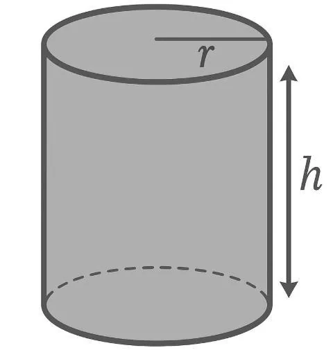

**Définition :** un cylindre est une forme géométrique « droite » avec une base circulaire.

**Formule :** pour calculer son volume, on utilise la relation : $V=π×r^2×h$ où :

- $r$ est le rayon de la base ;
- $h$ est la hauteur du cylindre ;
- $\pi \approx 3{,}14$.

Attention : ici on donne souvent le diamètre, il faut donc diviser par 2 pour obtenir le rayon.

**Exemple :** un cylindre de 3 m de rayon et 5 m de hauteur a un volume de : $V = \pi \times 3^2 \times 5 = \pi \times 9 \times 5 = 141{,}3\ \text{m}^3$.
