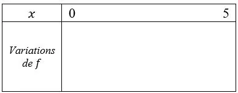

::: ouvrir http://www.youtube.com/watch?v=DMCAnDklHaQ
:::

Lors d'une démonstration de freestyle, une moto est lancée sur une rampe. On modélise la trajectoire de la moto par une parabole. La hauteur de la moto (en mètres) en fonction du temps (en secondes) est donnée par la relation $h(t)=-2t^2+8t+4{,}5$.

::: problematique
Au bout de combien de temps la moto retouche-t-elle le sol ? Quelle est la hauteur maximale du saut ?
:::

1. Calculer la hauteur de la moto au début du saut $(t=0)$.

2. Commenter l'évolution de la hauteur du saut en fonction du temps.

   On considère la fonction $f$ définie sur $[0\,;5]$ par $f(x)=-2x^2+8x+4{,}5$.

3. Compléter le tableau de valeurs du fichier suivant :

   ::: fichier fichiers/tableaux-de-valeurs-saut-moto.xlsx
   :::

4. À l'aide de la calculatrice NumWorks, représenter graphiquement la fonction $f$ sur l'intervalle $[0\,;5]$.

5. Compléter le tableau de variations de la fonction $f$ sur l'intervalle $[0\,;5]$.

   

6. Résoudre graphiquement l'équation $f(x)=0$ sur l'intervalle $[0\,;5]$.

7. Déterminer graphiquement la valeur de $x$ pour laquelle la fonction $f$ atteint son maximum.

8. Déterminer graphiquement le maximum de la fonction $f$ sur l'intervalle $[0\,;5]$.

9. Répondre à la problématique de l'activité.
