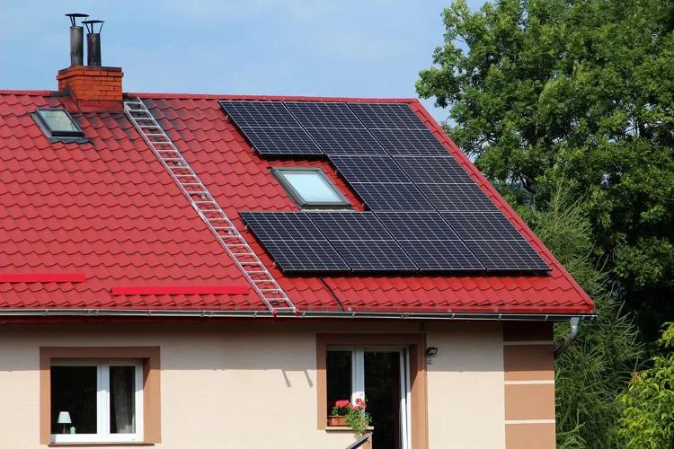
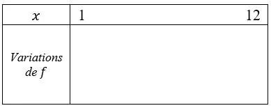
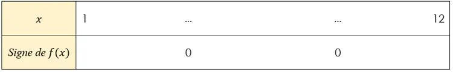

L'installation de panneaux solaires sur le toit de sa maison permet à un particulier de diminuer le montant de sa facture d'électricité. Certains mois, l'installation produit plus d'électricité qu'il n'en consomme, ce qui lui permet d'obtenir un bénéfice en revendant le surplus.

Le montant de la facture d'électricité en fonction du mois de l'année est modélisé par la fonction $f$ définie par $f(x)=4(x-3)(x-10)$ sur l'intervalle $[1\,;12]$ où $x$ représente le rang du mois (1 pour janvier, 2 pour février, etc.) et $f(x)$ représente le montant de la facture d'électricité en euro (€).

::: problematique
Pendant quelle période de l'année la production d'électricité est-elle excédentaire ?
:::

1. Calculer le montant de la facture d'électricité en février $(x=2)$.

2. Déterminer, en utilisant la méthode de son choix, les solutions de l'équation $f(x)=0$.

3. Déterminer l'abscisse du sommet de la parabole.

   ::: coup-de-pouce x-panneaux-courbe
   :::

4. Compléter le tableau de variations de la fonction $f$ sur l'intervalle $[1\,;12]$.

   

5. Compléter le tableau de signes de la fonction $f$.

   

6. Répondre à la problématique de l'activité.
