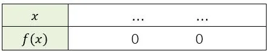

Le gérant d'un restaurant réalise un bénéfice maximum lorsque le taux d'occupation atteint 100 %. On modélise le bénéfice réalisé en fonction du taux d'occupation (en %) du restaurant par la fonction polynôme de degré 2 : $f(x)=-0{,}8x^2+160x-5120$ sur l'intervalle $[0\,;100]$. $x$ représente le taux d'occupation (en %) et $f(x)$ le bénéfice réalisé en euros (€).

::: problematique
Quel est le taux d'occupation minimum qui permet de réaliser un bénéfice positif ?
:::

1. Donner le taux d'occupation qui permet de réaliser un bénéfice maximum.

2. Calculer le bénéfice maximum réalisé par le restaurant.

3. Montrer que 160 est une racine du polynôme.

4. Calculer, par la méthode de son choix, la deuxième racine du polynôme.

   ::: coup-de-pouce x-deuxieme-racine
   :::

5. Écrire l'expression de la fonction $f$ sous forme factorisée.

6. Compléter le tableau de signes de la fonction $f$.

   

7. Répondre à la problématique de l'activité.
