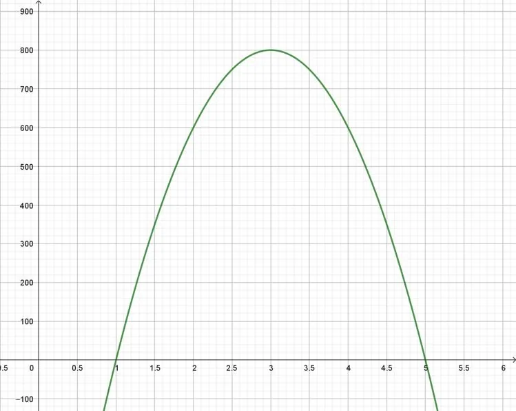

Le technicien d'un théâtre est chargé d'installer un projecteur pour éclairer la scène qui mesure 6 mètres de long. L'éclairement $E$ (en lux) en fonction de la position horizontale $x$ du projecteur est modélisé par la fonction suivante : $E(x)= -200x^2+1200x-1000$ où $x$ appartient à l'intervalle $[0\,;6]$.

::: problematique
Quelle zone de la scène sera éclairée par ce projecteur, et à quelle position l'éclairement sera-t-il maximal ?
:::

1. Calculer l'éclairement (en lux) à la position $x=2$.

   On considère la fonction $f$ définie par $f(x)=-200x^2+1200x-1000$ sur l'intervalle $[0\,;6]$.

   La représentation graphique de la fonction $f$ est donnée ci-dessous.

   

2. Déterminer graphiquement les solutions de l'équation $f(x)=0$.

3. À quoi correspondent ces solutions dans le contexte de l'activité ?

4. Déterminer graphiquement la valeur de $x$ pour laquelle la fonction $f$ atteint son maximum.

5. Déterminer graphiquement la valeur du maximum de la fonction $f$.

6. Répondre à la problématique de l'activité.
