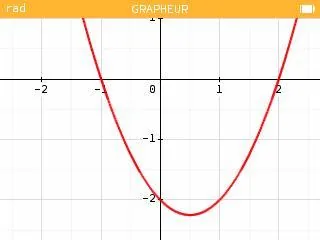
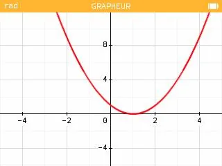
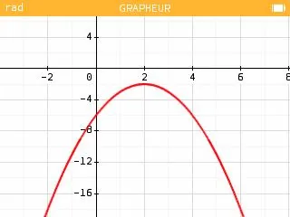

**Définition :** les racines d'un polynôme de degré 2 de la forme $f(x)=ax^2+bx+c$ (avec $a \neq 0$) sont les solutions de l'équation $f(x)=0$.

L'équation $f(x)=0$ peut avoir :

- **2 solutions :** lorsque la parabole coupe deux fois l'axe des abscisses.

**Exemple :** $f(x)=x^2-x-2$

Le polynôme a deux racines distinctes : $x_1=-1$ et $x_2=2$.

- **1 solution :** lorsque la parabole coupe une fois l'axe des abscisses.

**Exemple :** $f(x)=x^2-2x+1$

Le polynôme a une racine double : $x_1=x_2=1$.

- **Aucune solution :** lorsque la parabole ne coupe pas l'axe des abscisses.

**Exemple :** $f(x)=-x^2+4x-6$

Le polynôme n'a pas de racine.
