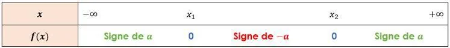
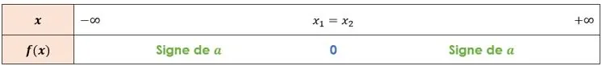
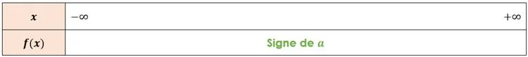

Propriétés

- Si un polynôme de degré 2 défini sous forme factorisée par $f(x)=a(x-x_{1})(x-x_{2})$ admet deux racines distinctes $x_{1}$ et $x_{2}$, alors ce polynôme est du signe de $-a$ pour les valeurs de $x$ comprises entre les racines $x_{1}$ et $x_{2}$.

- Si un polynôme de degré 2 défini sous forme factorisée par $f(x)=a(x-x_{1})^2$ admet une racine double ($x_{1}=x_{2}$) alors ce polynôme est du signe de $a$ de part et d'autre de sa racine.

- Si un polynôme de degré 2 n'admet aucune racine, alors ce polynôme est du signe de $a$.

**Exemple**

Le polynôme de degré 2 défini par $f(x)=2(x-1)(x-2)$ admet deux racines distinctes $x_{1}=1$ et $x_{2}=2$.

Dans ce cas $a$ est positif ($a=2$).

On a donc :

- $f(x)<0$ pour $1<x<2$ (du signe de $-a$ donc négatif entre les racines).
- $f(x)>0$ pour $x>2$ et pour $x<1$ (du signe de $a$ donc positif à l'extérieur des racines).
