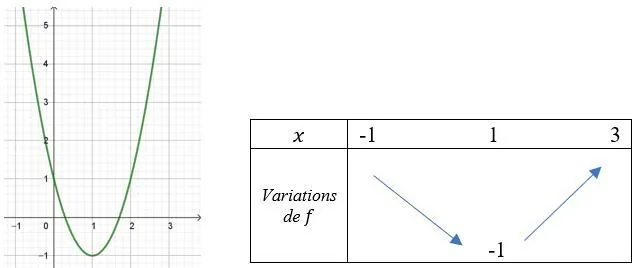
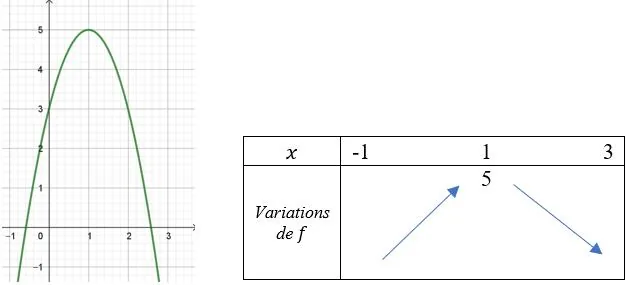

Définitions

- Les fonctions polynômes de degré 2 sont les fonctions de la forme $f(x)=ax^2+bx+c$ où $a$, $b$ et $c$ sont des nombres réels avec $a\ne 0$.
- La représentation graphique d'une fonction polynôme de degré 2 est une parabole.

**Propriété :** les variations de la fonction dépendent du signe du coefficient $a$.

- Si $a>0$, la parabole est ouverte vers le haut. La fonction est décroissante puis croissante, elle admet donc un minimum.

**Exemple :** $f(x)=2x^2-4x+1$

- Si $a<0$, la parabole est ouverte vers le bas. La fonction est croissante puis décroissante, elle admet donc un maximum.

**Exemple :** $f(x)=-2x^2+4x+3$

