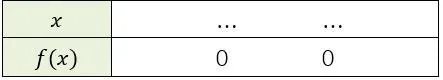

On considère la fonction $f$ définie par $f(x)=-x^2-2x+3$ sur l'intervalle $[-4\,;4]$.

1. Identifier les coefficients $a$, $b$ et $c$ du polynôme.

2. Calculer l'abscisse $x_{s}$ du sommet de la parabole en utilisant la relation $x_{s}=\frac{-b}{2a}$.

3. Montrer que $x_{1}=1$ est une racine du polynôme.

4. En utilisant l'égalité du milieu $x_{s}=\frac{x_{1}+x_{2}}{2}$, déterminer la deuxième racine $x_{2}$ du polynôme.

5. Écrire l'expression de la fonction $f$ sous forme factorisée.

6. Compléter le tableau de signes de la fonction $f$.

   
