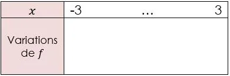

On considère la fonction $f$ définie par $f(x)=x^2-3x+2$ sur l'intervalle $[-3\,;3]$.

1. À l'aide du grapheur de la calculatrice NumWorks (ou de son émulateur en ligne, lien ci-dessous), représenter graphiquement la fonction $f$.

2. Déterminer graphiquement les solutions de l'équation $f(x)=0$.

3. Déterminer graphiquement l'abscisse $x_{s}$ du sommet de la parabole.

4. Déterminer graphiquement la valeur du minimum de la fonction.

5. Compléter le tableau de variations de la fonction $f$.

   
