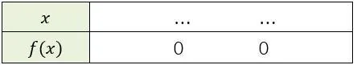

On considère la fonction $f$ définie par $f(x)=2(x-1)(x+4)$ sur l'intervalle $[-5\,;5]$.

1. Résoudre l'équation $f(x)=0$.

2. Compléter le tableau de signes de la fonction $f$ :

   

3. Calculer l'abscisse $x_{s}$ du sommet de la parabole.

4. Calculer la valeur du minimum de la fonction.
