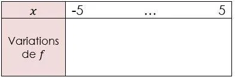

On considère la fonction $f$ définie sur l'intervalle $[-5\,;5]$ par $f(x)=-2x^2+8x+6$.

1. Identifier les coefficients $a$, $b$ et $c$ du polynôme.

2. Calculer l'abscisse $x_{s}$ du sommet de la parabole.

3. Calculer $f(x_s)$.

4. Compléter le tableau de variations de la fonction $f$.

   
