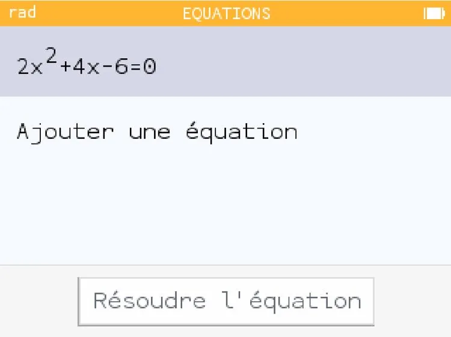
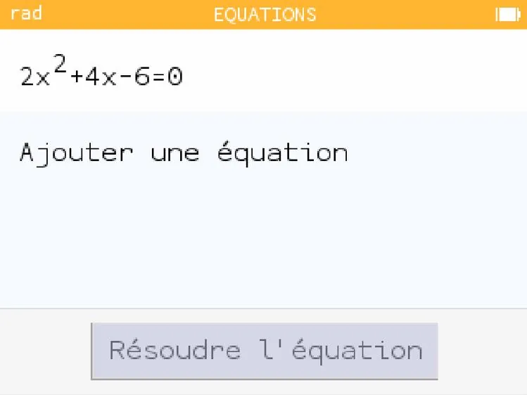
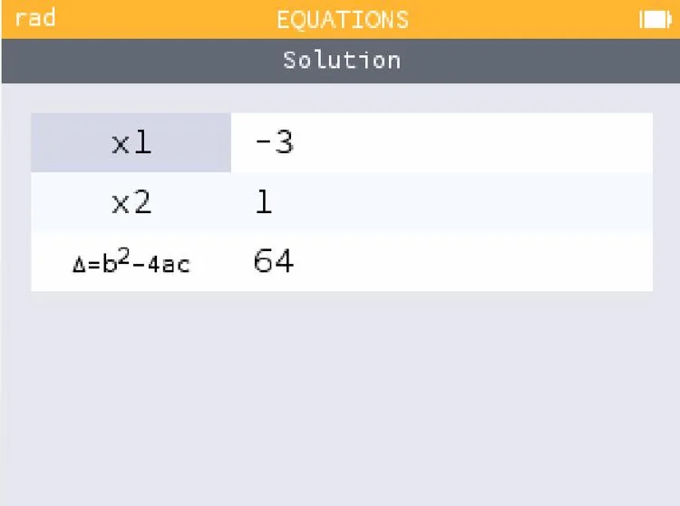

Déterminons les solutions de l'équation du second degré $2x^2+4x-6=0$.

1. Aller dans l'application **« Équations »** puis cliquer sur OK.

   

2. Saisir l'équation à résoudre puis cliquer sur OK.

   

3. Sélectionner « **Résoudre l'équation** ».

   

4. Les solutions de l'équation s'affichent.

   

   L'équation du second degré $2x^2+4x-6=0$ a deux solutions : $x_{1}=-3$ et $x_{2}=1$.
