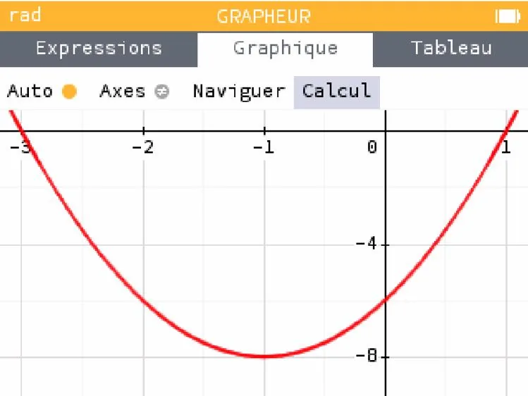
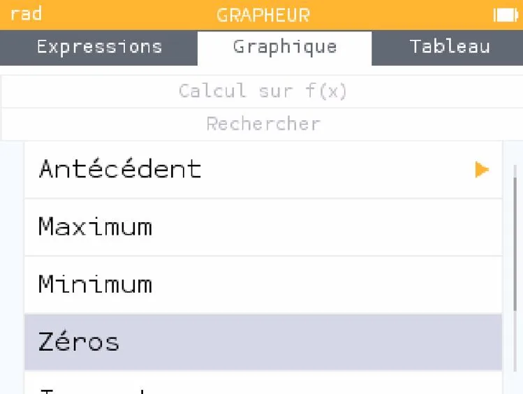
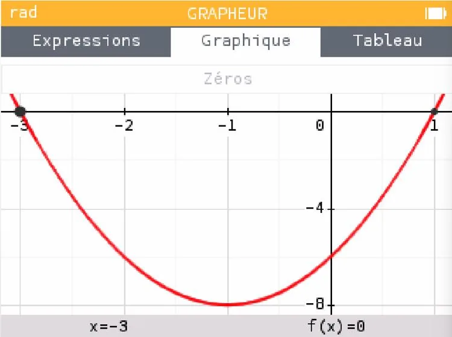

Déterminons graphiquement les racines de la fonction polynôme de degré 2 $f(x)=2x^2+4x-6$.

1. Aller dans l'application **« Grapheur »** puis cliquer sur OK.

   

2. Rester dans l'onglet **« Expressions »** et saisir l'expression de la fonction $f$.

   

3. À l'aide des flèches, cliquer sur **« Tracer le graphique »**.

   

4. Dans l'onglet **« Graphique »**, aller sur **« Calcul »** puis cliquer sur OK.

   

5. La fenêtre suivante apparaît. Aller sur l'onglet **« Rechercher »** puis cliquer sur OK.

   

6. Sélectionner **« Zéros »** puis cliquer sur OK.

   

7. Les coordonnées des racines apparaissent en bas du graphique. Le polynôme $f(x)=2x^2+4x-6$ a deux racines : $x_1=-3$ et $x_2=1$.

   
