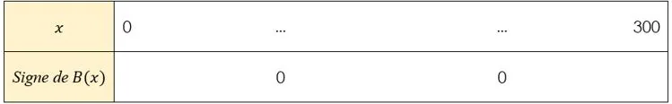

Une petite entreprise fabrique des pièces mécaniques sur mesure pour l’industrie locale. Chaque pièce est vendue 95 € et le coût de production dépend du nombre de pièces fabriquées.

- Quand la production est faible, les coûts sont élevés à cause des frais fixes et de la sous-utilisation des machines.
- Si la production augmente trop, les coûts augmentent fortement en raison de la maintenance des machines et du prix de l'énergie.

Le coût de production pour $x$ pièces est modélisé par la fonction $C(x)=0{,}5x^2-30x+1872$ sur l'intervalle $[0\,;300]$.

La recette est donnée par la fonction $R(x)=95x$.

Pour calculer le bénéfice réalisé pour $x$ pièces vendues, on soustrait le coût de production à la recette $B(x)=R(x)-C(x)$.

::: problematique
Combien de pièces l'entreprise doit-elle fabriquer pour obtenir le bénéfice maximal ?
:::

::: coup-de-pouce x-benefice
Des indications, question par question.
:::

1. Calculer le bénéfice réalisé pour 100 pièces fabriquées.

2. Montrer que le bénéfice $B(x)$ peut s'écrire $B(x)=-0{,}5x^2+125x-1872$.

3. Résoudre, avec la méthode de son choix, l'équation $B(x)=0$.

4. Écrire le polynôme $B(x)$ sous forme factorisée.

5. Compléter le tableau de signes de la fonction.

   

6. Déterminer l'abscisse $x_{s}$ du sommet de la parabole.

7. Calculer le maximum de la fonction $B$.

8. Combien l'entreprise doit-elle produire de pièces pour gagner de l'argent ?

9. Répondre à la problématique de l'activité.
