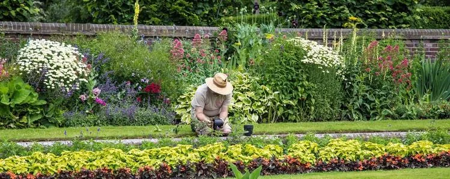

Dans une entreprise d'aménagement paysager, un jardinier est chargé de concevoir un parterre de fleurs rectangulaire le long d'un mur. Il dispose de 26 m de bordure pour entourer trois côtés du parterre (le quatrième côté est appuyé sur le mur du jardin).

::: problematique
Quelles doivent être les dimensions du parterre pour que l'aire du parterre soit maximale ? Quelle est l'aire maximale du parterre de fleurs ?
:::

::: coup-de-pouce x-parterre
Des indications, question par question.
:::

On nomme $x$ la longueur du côté perpendiculaire au mur, exprimée en mètres.

1. À l'aide de la simulation GeoGebra ci-dessous, déterminer l'aire du parterre de fleurs pour $x=2$ puis $x=9$.

   ::: ouvrir https://www.geogebra.org/classic/xcjdd2aj
   :::

2. Exprimer la longueur $L(x)$ du côté parallèle au mur en fonction de $x$.

3. Montrer que l'aire $A(x)$ du parterre de fleurs peut s'écrire $A(x)=-2x(x-13)$.

4. Déterminer les racines du polynôme $A(x)$.

5. Calculer l'abscisse $x_{s}$ du sommet de la parabole.

6. Calculer l'aire maximum du parterre de fleurs.

7. Valider votre résultat à l'aide de la simulation.

8. Répondre à la problématique de l'activité.
