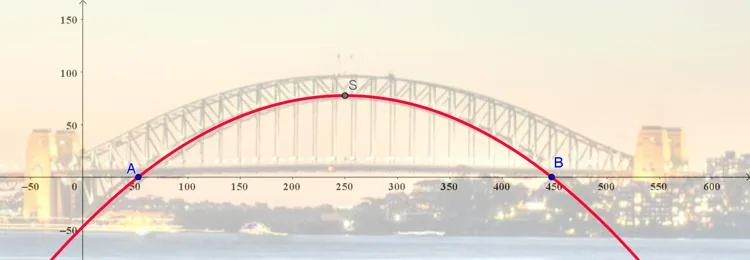

Une entreprise australienne est responsable de l'entretien du tablier du Harbour Bridge, à Sydney. Elle doit remplacer le revêtement de la portion du tablier située sous l’arche inférieure du pont.

::: problematique
Sur quelle distance le revêtement devra-t-il être remplacé ?
:::

::: coup-de-pouce x-sydney
Des indications, question par question.
:::

On modélise la forme de l'arche inférieure du Harbour Bridge par la fonction polynôme de degré 2 notée $f$, définie sur l'intervalle $[0\,;500]$ et représentée ci-dessous.

1. Choisir parmi les propositions suivantes l'expression algébrique qui correspond à la fonction $f$. Justifier la réponse.

   - $f(x)=0{,}002x^2+x-47{,}382$
   - $f(x)=-0{,}002x^2+x-47{,}382$
   - $f(x)=-0{,}002x^2+x+47{,}382$

2. Montrer que $x_{1}=53$ est une racine du polynôme.

3. Sachant que les coordonnées du point $S$ (sommet de la parabole) sont $S(250\,;\,77{,}618)$, calculer la deuxième racine $x_{2}$ du polynôme.

4. En déduire la distance $AB$.

5. Répondre à la problématique de l'activité.
