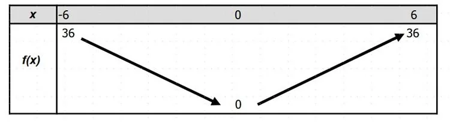

La fonction carré est décroissante pour $x \leq 0$ et croissante pour $x \geq 0$.

Elle atteint son minimum, 0, pour $x=0$.

**Exemple :** tableau de variations de la fonction $f(x)=x^2$ sur l'intervalle $[-6\,;6]$.

