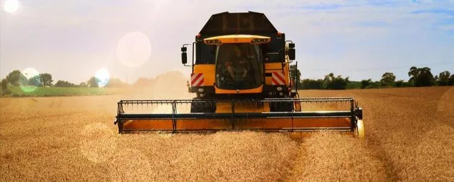
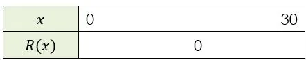

Un agriculteur souhaite optimiser le rendement de son champ de blé. Après plusieurs années d'expérimentation, il a établi que le rendement $R(x)$ de sa parcelle (en quintaux par hectare) dépend de la quantité $x$ d'engrais utilisée (en dizaines de kg par hectare) selon la relation : $R(x) = -x^2 + 20x + 96$ avec $x\in[0\,;30]$.

::: problematique
Quelle quantité d'engrais l'agriculteur doit-il utiliser pour obtenir un rendement maximum ? Quel sera alors le rendement maximum ?
:::

:::: competence S'approprier · Communiquer

1. Déterminer $R(0)$.

2. Que signifie cette valeur dans le contexte agricole ?

::::

:::: competence Réaliser

3. Montrer que $x_{1}=-4$ et $x_{2}=24$ sont les racines du polynôme $R(x)$.

4. Écrire le polynôme $R(x)$ sous forme factorisée.

5. Compléter le tableau de signes de la fonction $R$ sur l'intervalle $[0\,;30]$.

   

::::

:::: competence Analyser-raisonner

6. Proposer une méthode pour déterminer l'abscisse $x_{s}$ du sommet de la parabole.

   ::: remarque Appel
   Appeler le professeur et lui expliquer la démarche.
   :::

::::

:::: competence Réaliser

7. Calculer l'abscisse $x_{s}$ du sommet de la parabole.

8. Calculer la valeur du maximum de la fonction $R$.

::::

:::: competence Valider

9. À l'aide de l'émulateur de la calculatrice NumWorks, représenter graphiquement la fonction $R$ et valider les résultats.

   ::: remarque Appel
   Appeler le professeur et lui montrer la représentation graphique.
   :::

::::

:::: competence Valider · Communiquer

10. Répondre par une phrase à la problématique.

::::
