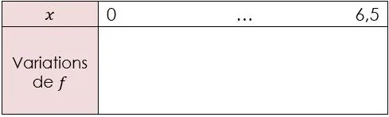

Vous participez à un salon professionnel pour présenter votre formation. Votre classe tient un stand entre l'ouverture du salon à 9 h 00 et sa fermeture à 15 h 30. Vous devez organiser les équipes afin de gérer au mieux le pic de fréquentation du stand.

Les organisateurs ont analysé les entrées et estiment que la fréquentation du stand au cours du temps suit une courbe modélisable par une fonction polynôme de degré 2. Le nombre de visiteurs en fonction du temps écoulé depuis l'ouverture est modélisé par la fonction définie par $f(x)=-2{,}5x^2+12{,}5x+24{,}375$ sur l'intervalle $[0\,;6{,}5]$ où :

- $x$ est le temps écoulé depuis l’ouverture du salon (en heure) ;
- $f(x)$ est le nombre de visiteurs attendus au bout de $x$ heures.

::: problematique
À quelle heure le stand sera-t-il le plus fréquenté ? Quel sera alors le nombre maximum de visiteurs attendu ?
:::

:::: competence S'approprier

1. Combien de temps s'écoule entre l'ouverture et la fermeture du salon ?

2. Identifier les coefficients $a$, $b$ et $c$ du polynôme de degré 2.

::::

:::: competence Analyser-raisonner

3. Proposer une méthode pour déterminer l'heure où le nombre de visiteurs sera maximal.

   ::: remarque Appel
   Appeler le professeur et lui expliquer la démarche.
   :::

::::

:::: competence Réaliser

4. Calculer le nombre de visiteurs à 9 h 30 (une demi-heure après l'ouverture).

5. En utilisant la relation $x_{s}=\frac{-b}{2a}$, calculer l'abscisse $x_{s}$ du sommet de la parabole.

6. Calculer la valeur du maximum de la fonction $f$.

::::

:::: competence Valider

7. Compléter le tableau de variations de la fonction $f$.

   

::::

:::: competence Valider · Communiquer

8. Répondre par une phrase à la problématique.

::::
