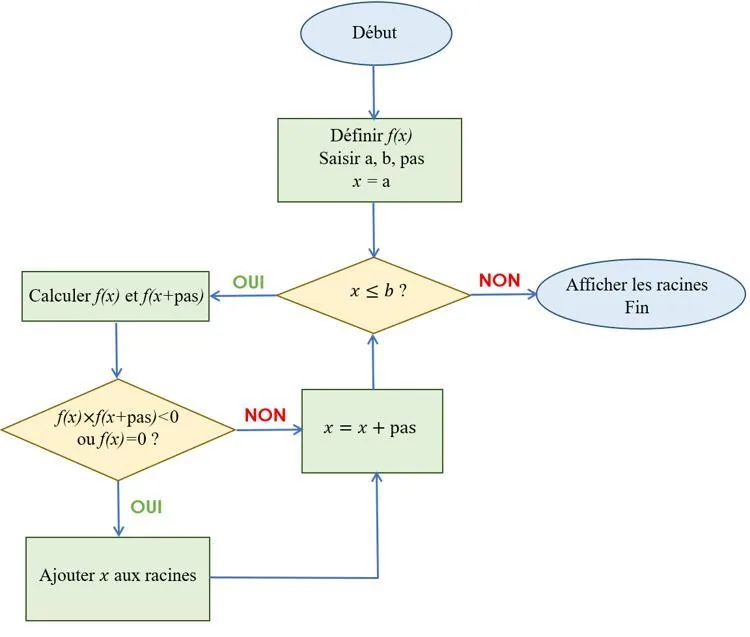

Le programme parcourt un intervalle $[a;b]$ défini par l'utilisateur par pas de $0{,}01$ pour détecter les points où la fonction change de signe ou s'annule, ce qui permet de repérer les racines approximatives d’un polynôme du second degré.

Algorigramme

