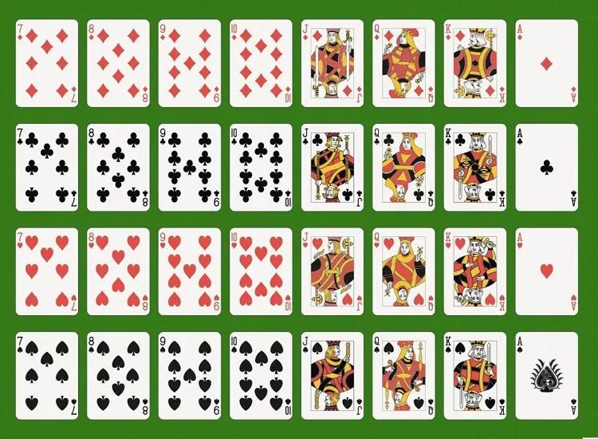

Zackaria propose un jeu de chance à ses camarades. Il leur demande de tirer une carte au hasard dans un jeu de 32 cartes. Le joueur gagne s'il tire un roi ou un cœur.

::: problematique
Quelle est la probabilité pour le joueur de gagner à ce jeu ?
:::

On considère les deux événements suivants.

- L'événement $A$ : « *Le joueur tire un cœur*. »
- L'événement $B$ : « *Le joueur tire un roi.* »

1.
   1. Repérer sur le dessin les issues favorables à l'événement $A$.

   2. Calculer la probabilité $p(A)$ de l'événement $A$.

2.
   1. Repérer sur le dessin les issues favorables à l'événement $B$.

   2. Calculer la probabilité $p(B)$ de l'événement $B$.

::: remarque Intersection d'événements
l'intersection de deux événements $A$ et $B$, notée $A \cap B$ (se lit « A inter B »), est l'ensemble des issues communes aux deux événements. L'événement $A \cap B$ signifie : « *Le joueur tire un cœur ET le joueur tire un roi.* »
:::

3.
   1. Déterminer l'ensemble des issues favorables à l'événement $A \cap B$.

   2. Calculer la probabilité $p(A \cap B)$ de cet événement.

::: remarque Réunion d'événements
la réunion de deux événements $A$ et $B$, notée $A \cup B$ (se lit « A union B »), est l'ensemble des issues favorables à l'événement $A$ ou à l'événement $B$. L'événement $A \cup B$ signifie : « *Le joueur tire un cœur OU le joueur tire un roi.* »
:::

4.
   1. Repérer sur le dessin les issues favorables à l'événement $A\cup B$.

   2. Calculer la probabilité $p(A\cup B)$ de cet événement.

5. Répondre à la problématique.
