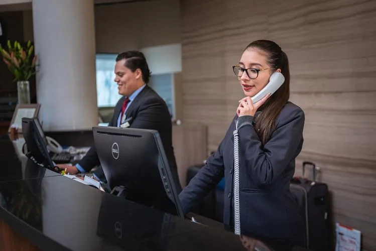

Le directeur d'un hôtel de 80 chambres constate que, en moyenne, 15 % des clients annulent leur réservation la veille de leur arrivée. Il souhaite améliorer son taux d'occupation en pratiquant le surbooking (accepter plus de réservations que le nombre de chambres disponibles).

::: problematique
Le directeur peut-il se permettre de réserver 10 chambres de plus que le nombre de chambres disponibles ?
:::

On considère l'événement $A$ : « *Le client annule sa réservation ».*

1. Donner la probabilité $p(A)$ de l'événement $A$.

   On note $\overline{A}$ l'événement contraire de $A$.

2. Définir par une phrase l'événement $\overline{A}$.

3. Calculer la probabilité $p(\overline{A})$ de l'événement $\overline{A}$.

4. Vérifier que $p(A)+p(\overline{A})=1$.

5. Calculer le nombre de chambres qui seront probablement occupées si toutes les chambres disponibles sont réservées.

6. Calculer le nombre de chambres qui seront probablement occupées si le directeur réserve 10 chambres de plus que le nombre de chambres disponibles.

7. Quels sont les avantages et les inconvénients de pratiquer le surbooking ?

8. Répondre à la problématique de l'activité.
