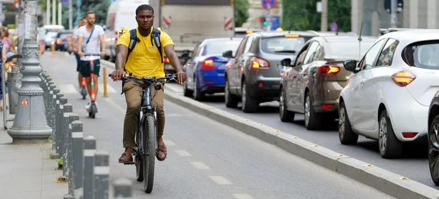
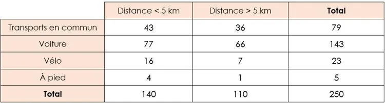

Une entreprise souhaite mettre en place une mesure incitative si plus de la moitié des employés qui habitent à moins de 5 kilomètres de l'entreprise utilisent la voiture pour s'y rendre.

La direction interroge les 250 employés de l'entreprise sur le moyen de transport utilisé et sur la distance entre le domicile et le travail. Les résultats de l'enquête sont réunis dans le tableau suivant.

::: problematique
L'entreprise va-t-elle prendre la décision d'une mesure incitative ?
:::

1. Donner le nombre d'employés habitant à moins de 5 km de l'entreprise.

2. Donner le nombre d'employés qui utilisent la voiture et habitent à moins de 5 km de l'entreprise.

3. Calculer la fréquence (pourcentage) des employés qui se rendent au travail en voiture parmi ceux qui habitent à moins de 5 km de l'entreprise.

   On interroge un employé au hasard dans l'entreprise. On considère les deux événements suivants.

   - L'événement $H$ : « L’employé interrogé habite à moins de 5 km de l’entreprise. »
   - L'événement $V$ : « L’employé interrogé utilise la voiture pour se rendre au travail. »

4. Calculer la probabilité $p(H)$ de l'événement $H$.

5.
   1. Définir par une phrase l'événement $H \cap V$.

   2. Calculer la probabilité $p(H\cap V)$ de cet événement.

6.
   1. Calculer $\frac{p(H\cap V)}{p(H)}$.

   2. Comparer le résultat avec celui trouvé à la question **3**.

7. L'entreprise va-t-elle prendre la décision d'une mesure incitative ?
