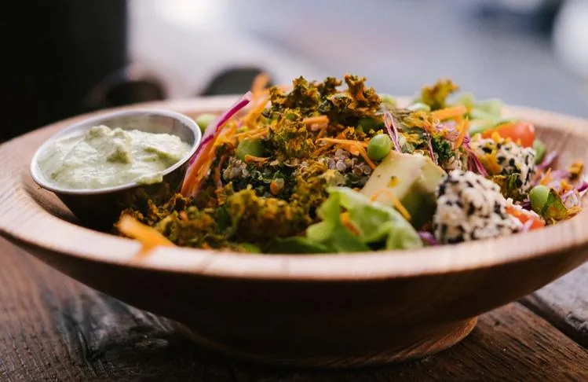
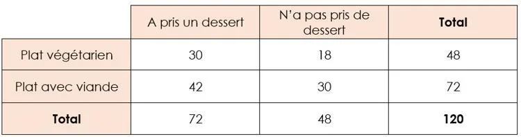

Un restaurateur propose dans son menu un plat avec viande ou un plat végétarien et un dessert en option. Il réalise une étude statistique sur les choix des 120 derniers clients.

Les résultats sont présentés dans le tableau suivant.

::: problematique
Pour améliorer la gestion de ses stocks, le restaurateur souhaite connaître la probabilité pour qu'un client pris au hasard dans le restaurant choisisse un plat avec viande ou qu'il prenne un dessert.
:::

On choisit un client au hasard dans le restaurant et on considère les deux événements suivants.

- L'événement $A$ : « *Le client a choisi un plat avec viande.* »
- L'événement $B$ : « *Le client a pris un dessert.* »

1. Calculer la probabilité $p(A)$ de l'événement $A$.

2. Calculer la probabilité $p(B)$ de l'événement $B$.

3.
   1. Définir par une phrase l'événement $A \cap B$.

   2. Calculer la probabilité $p(A \cap B)$ de cet événement.

4.
   1. Définir par une phrase l'événement $A \cup B$.

   2. Calculer la probabilité $p(A \cup B)$ de cet événement.

5. Répondre à la problématique de l'activité.
