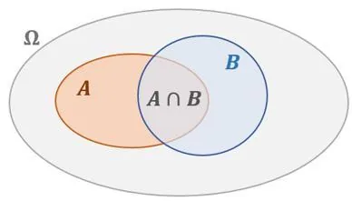
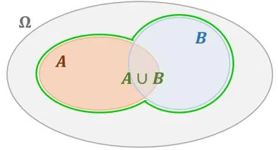

**Intersection d'événements**$A\cap B$

**Définition :** l’intersection de deux événements $A$ et $B$, notée $A\cap B$ (se lit « A inter B »), est l’ensemble des issues communes à l'événement $A$ **ET** à l'événement $B$.

**Réunion d'événements** $A \cup B$

**Définition :** la réunion de deux événements $A$ et $B$, notée $A \cup B$ (se lit « A union B »), est l’ensemble des issues favorables à l’événement $A$ **OU** à l’événement $B$.

Formules

Pour calculer la probabilité de la réunion de deux événements $A$ et $B$ :

- Si les événements $A$ et $B$ sont compatibles (leur réalisation simultanée est possible) :
$p(A \cup B)=p(A)+p(B)-p(A\cap B)$ ;
- Si les événements $A$ et $B$ sont incompatibles (leur réalisation simultanée est impossible) : $p(A\cap B)=0$, donc $p(A \cup B)=p(A)+p(B)$.

