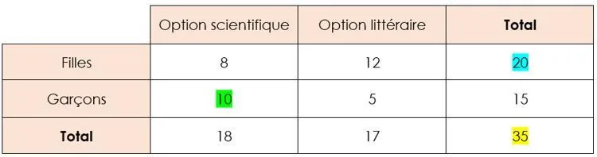

**Définition :** un tableau croisé d'effectifs (ou tableau à double entrée) permet de compter le nombre d'individus correspondant à chaque combinaison de deux critères.

**Exemple :** un professeur interroge sa classe sur deux critères, fille ou garçon et option scientifique ou littéraire. Il obtient les résultats suivants.

Il y a 35 élèves dans la classe.

Il y a 20 filles au total dans la classe.

Il y a 10 garçons qui ont choisi l'option scientifique.
