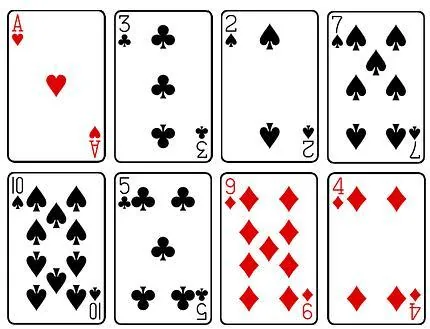

On tire au hasard une carte parmi les 8 cartes ci-dessous.

1. Calculer la probabilité d'obtenir un as.

2. Calculer la probabilité d'obtenir un pique.

3. Calculer la probabilité d'obtenir un carreau.

4. Calculer la probabilité d'obtenir une carte noire.
