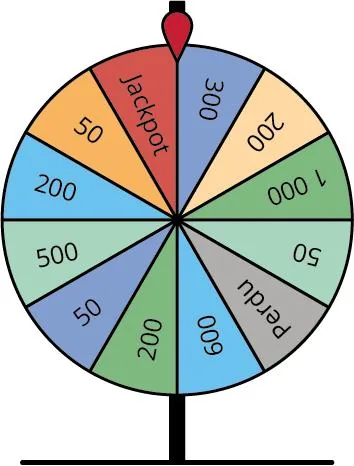

La roue de tombola suivante est divisée en 12 secteurs.

1. Calculer la probabilité d'obtenir le jackpot.

2. Calculer la probabilité d'obtenir 200 €.

3. Calculer la probabilité d'obtenir au moins 500 €.
