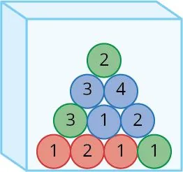

L'urne ci-dessous contient des jetons colorés et numérotés, indiscernables au toucher. On tire au hasard un jeton dans l'urne.

1. Calculer la probabilité d'obtenir un jeton rouge.

2. Calculer la probabilité d'obtenir un jeton portant le numéro 1.

3. Calculer la probabilité d'obtenir un jeton rouge et portant le numéro 1.

4. Calculer la probabilité d'obtenir un jeton rouge ou un jeton portant le numéro 1.
