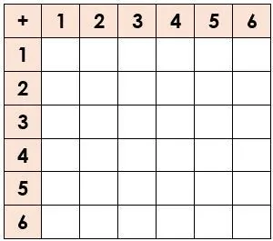

Dans un jeu de société, il faut réaliser un double 6 lors d'un lancer de deux dés à 6 faces pour sortir de la case prison. Quelle est la probabilité d'obtenir un double 6 lors d'un lancer de deux dés à 6 faces ?

### Estimer la probabilité d'obtenir un double6

Le programme Python suivant définit la fonction **tirage(N)** à un paramètre : **N** (le nombre de lancers). La fonction **tirage(N)** simule **N** lancers de deux dés à 6 faces et calcule la fréquence d'obtention du double 6.

**Exemple :** **tirage(10)** simule 10 lancers de deux dés à 6 faces et calcule la fréquence d'obtention du double 6.

1. Ouvrir et exécuter le programme.

   ::: ouvrir https://console.basthon.fr/?script=eJxLK8rPVShKzEsBUpm5BflFJVq8XCmpaQolmUWJ6akafppWvFwKQJBnawBhpOUXKWQqZOaBdAEVGOr4aRvCFIFAkC3IuMy8EqCUmaY2MgehKDMNqM7W0AhJH8SSPG1DhFCabVF-aV6KRp6-n44xVHdRaklpUZ5GmiYA4wst5A
   :::

2. Tester la fonction **tirage(N)** pour 10, 50, 100, 1 000, 10 000 et 100 000 lancers.

3. Estimer la probabilité d'obtenir un double 6 lors d'un lancer de deux dés à 6 faces.

   **Rappel :** lorsqu'on augmente le nombre de lancers, la fluctuation de la fréquence diminue et se stabilise vers une fréquence proche de la probabilité.

### Calculer la probabilité d'obtenir un double6

4. Lister toutes les combinaisons possibles avec deux dés à 6 faces dans le tableau à double entrée suivant en faisant la somme des résultats obtenus avec chacun des dés.

   

5. Calculer la probabilité d'obtenir un double 6 (résultat 12) lors d'un lancer de deux dés à 6 faces. Arrondir le résultat au millième.

6. Comparer le résultat obtenu avec le résultat estimé à l'aide de la simulation.

```python
from random import*
def tirage(N):
    n=0
    for i in range(1,N+1):
        R=randint(1,6)+randint(1,6)
        if R==12:
            n=n+1
        f=round(n/N,3)
    return(f)
```
