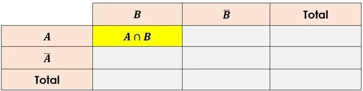
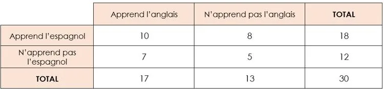

### Intersection de deux événements $A$ et $B$

**Exemple**

Il y a 30 élèves dans une classe. Ceux-ci apprennent soit l'anglais, soit l'espagnol, soit les deux. Le tableau croisé d'effectifs suivant indique le nombre d'élèves selon la langue apprise.

On considère les deux événements suivants.

- L'événement $A$ : *« L'élève apprend l'anglais. »*
- L'événement $E$ : *« L'élève apprend l'espagnol. »*

1. L'événement $A\cap E$ peut s'écrire : *« L'élève apprend l'anglais et l'espagnol. »*

2. D'après le tableau, 10 élèves correspondent à l'événement $A\cap E$.

3. La probabilité qu'un élève choisi au hasard dans la classe apprenne l'anglais et l'espagnol est $p(A\cap E)=\frac{10}{30}=\frac{1}{3}\approx0{,}33$.
