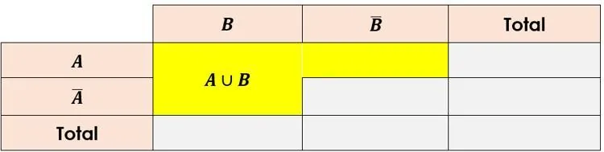
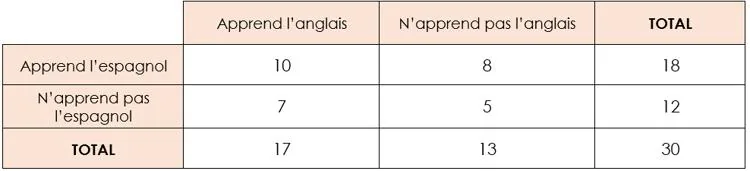

### Réunion de deux événements $A$ et $B$

**Exemple**

Il y a 30 élèves dans une classe. Ceux-ci apprennent soit l'anglais, soit l'espagnol, soit les deux. Le tableau croisé d'effectifs suivant indique le nombre d'élèves selon la langue apprise.

On considère les deux événements suivants.

- L'événement $A$ : *« L'élève apprend l'anglais. »*
- L'événement $E$ : *« L'élève apprend l'espagnol. »*

1. L'événement $A\cup E$ peut s'écrire : *« L'élève apprend l'anglais ou l'espagnol. »*

2. Pour dénombrer les élèves qui correspondent à l'événement $A\cup E$, il faut compter les 8 élèves qui apprennent l'anglais et pas l'espagnol, les 7 élèves qui apprennent l'espagnol et pas l'anglais et les 10 élèves qui apprennent les deux langues.
   $8+7+10=25$
   Donc 25 élèves au total correspondent à l'événement $A\cup E$.

3. La probabilité qu'un élève choisi au hasard dans la classe apprenne l'anglais ou l'espagnol est $p(A\cup E)=\frac{25}{30}=\frac{5}{6}\approx0{,}83$.
