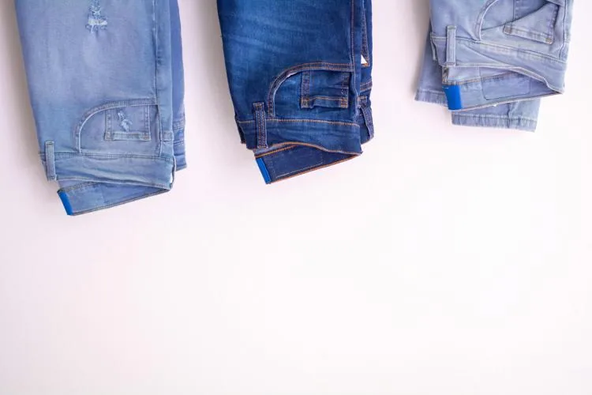

Une entreprise de confection textile produit 17 000 pantalons pour femmes par an. En contrôlant la production sur une année, on trouve que 1 190 pantalons ont un défaut de teinte, 1 870 ont un défaut de couture et 510 cumulent les deux défauts. Si la probabilité qu'un pantalon soit défectueux dépasse 10 %, la directrice met en place un contrôle qualité.

::: problematique
La directrice de l'entreprise devra-t-elle mettre en place un contrôle qualité ?
:::

On choisit un pantalon au hasard dans la production annuelle de l'entreprise. On considère les deux événements suivants.

- L'événement $T$ : « *Le pantalon présente un défaut de teinte.* »
- L'événement $C$ : « *Le pantalon présente un défaut de couture.* »

::: coup-de-pouce x-pantalons
:::

1. Construire et compléter le tableau croisé d'effectifs.

2. Calculer la probabilité pour que le pantalon ait l'un ou l'autre des deux défauts.

3. Répondre à la problématique.
