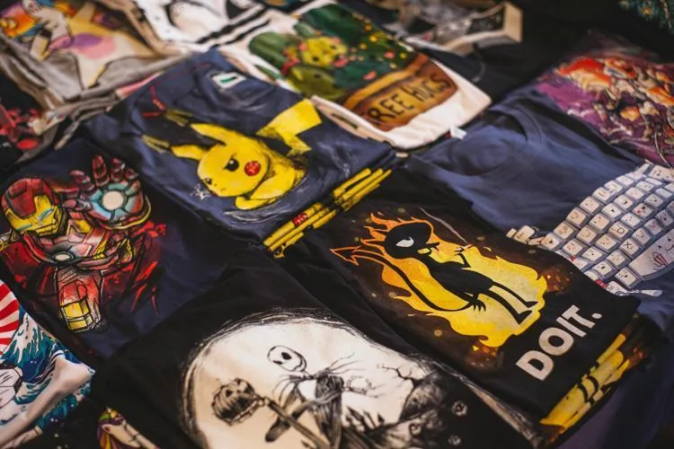

Une entreprise vend des T-shirts personnalisés sur son site web. Une étude sur 300 commandes récentes montre que :

- 180 clients ont demandé une impression au dos ;
- 135 clients ont demandé une couleur personnalisée ;
- 45 clients ont demandé les deux options.

::: problematique
La gérante de l'entreprise souhaite augmenter les frais engagés dans la publicité en ligne si la probabilité qu'un client demande l'une ou l'autre des deux options est inférieure à 85 %.
:::

On choisit un client au hasard et on considère les deux événements suivants.

- L'événement $A$ : « *Le client demande une impression au dos.* »
- L'événement $B$ : « *Le client demande une couleur personnalisée.* »

:::: competence S'approprier

1. Donner la notation de l'événement : « *Le client demande une impression au dos ou une couleur personnalisée.* »

::::

:::: competence Analyser-raisonner

2. Quelles sont les probabilités nécessaires pour calculer la probabilité de cet événement ?

   ::: remarque Appel
   Appeler le professeur pour expliquer la démarche.
   :::

::::

:::: competence Réaliser

3. Télécharger et compléter le tableau croisé d'effectifs suivant.

   ::: fichier fichiers/t-shirt.xlsx
   :::

   ::: remarque Appel
   Appeler le professeur et faire vérifier les calculs.
   :::

4. Calculer la probabilité $p(A)$ qu'un client demande une impression au dos.

5. Calculer la probabilité $p(B)$ qu'un client demande une couleur personnalisée.

6. Calculer la probabilité $p(A\cap B)$ qu'un client demande une impression au dos et une couleur personnalisée.

7. Calculer la probabilité $p(A\cup B)$ qu'un client demande une impression au dos ou une couleur personnalisée.

::::

:::: competence Valider · Communiquer

8. La gérante de l'entreprise va-t-elle augmenter les frais engagés dans la publicité en ligne ? Justifier la réponse.

::::
