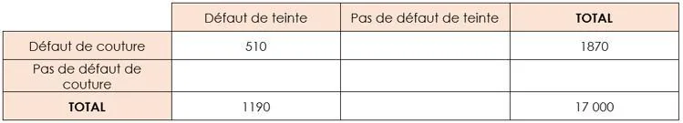

1. Les informations de l'énoncé sont correctement placées dans le tableau suivant.

   

2. Calculer les probabilités $p(T)$, $p(C)$ et $p(T\cap C)$ puis calculer la probabilité $p(T\cup C)$.

   **Rappel :** $p(A\cup B)=p(A)+p(B)-p(A\cap B)$

3. Comparer la valeur obtenue avec 10 % pour répondre à la problématique.
