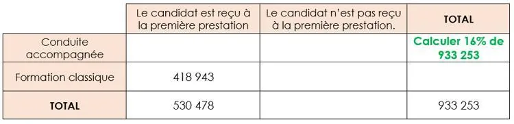

1. Les informations de l'énoncé sont correctement placées dans le tableau suivant.

   

2.

   1. La notation $\overline{A}$ désigne l'événement contraire de l'événement $A$.

   2. $p(\overline{A})=1-p(A)$

5. On calcule une probabilité conditionnelle en utilisant le tableau croisé d'effectifs ou en utilisant la relation $p_{A}(R)=\frac{p(A\cap R)}{p(A)}$.

7. Pour répondre à la problématique, il faut comparer $p_{A}(R)$ et $p_{\overline{A}}(R)$.
