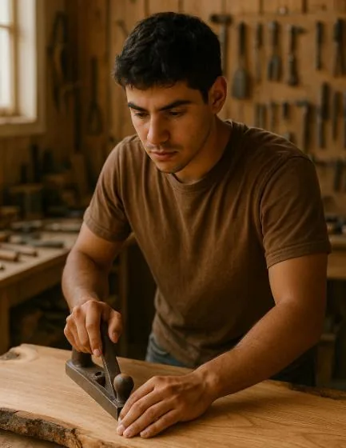

Roberto a monté son atelier de menuiserie à la sortie du lycée. Il fabrique des tables basses en chêne massif, vendues sur commande dans un esprit « artisan designer ».

Pour lancer son activité, il a dû :

- investir 4 800 € dans du matériel professionnel (raboteuse-dégauchisseuse, lamelleuse, outils Festool, etc.) ;
- dépenser 220 € en matières premières et consommables pour chaque table fabriquée (chêne PEFC, finitions écologiques, électricité, etc.) ;
- vendre chaque table 850 €.

### Partie 1 — Vente de 10 tables

Roberto fabrique et vend 10 tables.

1. Combien d’euros aura-t-il gagnés en tout grâce aux ventes ?
2. Combien d’euros aura-t-il dépensés en tout pour les fabriquer ?
3. Roberto aura-t-il réalisé un bénéfice ou non ? Justifier la réponse par un calcul.

### Partie 2 — Modélisation des fonctions de gain et de coût

On note $x$ le nombre de tables fabriquées et vendues.

1. Proposer une fonction $f(x)$ représentant le gain total de Roberto.

2. Proposer une fonction $g(x)$ représentant la dépense totale de Roberto.

3. Tracer les deux fonctions $f$ et $g$ sur GeoGebra.

   ::: coup-de-pouce m-tracer-geogebra
   :::

4. Déterminer le point d’intersection des courbes des fonctions $f$ et $g$.

   ::: coup-de-pouce m-intersection-geogebra
   :::

5. À partir de combien de tables Roberto commence-t-il à faire du bénéfice ? Expliquer la réponse.

### Question bonus

6. Proposer une troisième fonction qui représenterait le bénéfice net de Roberto en fonction du nombre de tables vendues.

   
