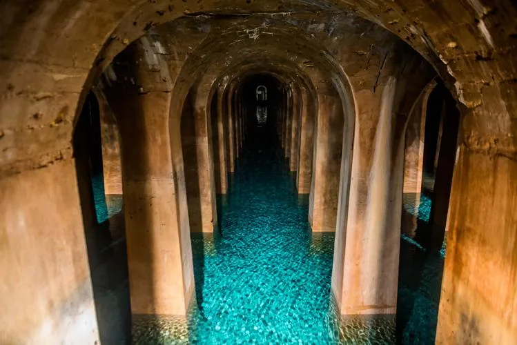

Une ville utilise un réservoir d'eau pour alimenter ses habitants. La quantité d'eau dans le réservoir varie selon les heures de la journée, en fonction de la consommation et du remplissage.

La quantité d'eau $Q(t)$ (en milliers de m³) dans le réservoir en fonction du temps $t$ (en heure, où $t = 0$ correspond à minuit) est donnée par la fonction : $Q(t) = -0{,}5t^2 + 8t + 120$ pour $0 \leq t \leq 24$.

La ville considère que le niveau d'eau est critique si la quantité descend en dessous de 100 000 m³.

::: problematique
À quels moments de la journée cela se produit-il ?
:::

1. Tracer la fonction $Q(t)$ sur l'intervalle $[0\,;24]$.

   ::: coup-de-pouce m-tracer-numworks
   :::

2. À partir du graphique, déterminer :
   1. la quantité d'eau à 14 h ;
   2. le moment où le réservoir contient le plus d'eau ;
   3. la quantité minimale d'eau dans le réservoir.

      ::: coup-de-pouce m-images-numworks
      :::

      ::: coup-de-pouce m-extremum-numworks
      :::

3. Déterminer les périodes où le niveau est critique et répondre à la problématique.

   

   *Réservoir de Montsouris fournissant l'eau de Paris Sud*
