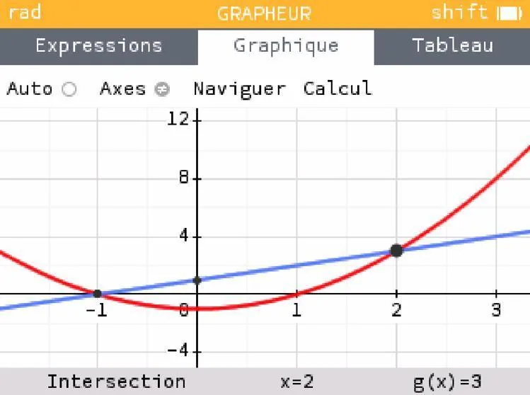
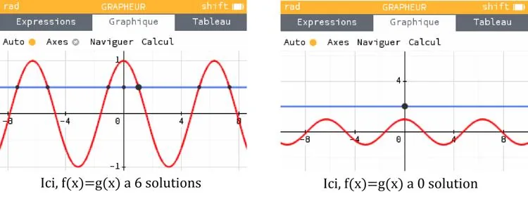

Résoudre graphiquement une équation de la forme $f(x)=g(x)$ consiste à repérer les points d’intersection des deux courbes représentatives des fonctions $f$ et $g$.

Pour cela, on trace généralement les fonctions à l’aide d’un outil numérique (comme la calculatrice NumWorks), puis on identifie les abscisses des points où les courbes se croisent.

**Exemple :** soit les fonctions définies pour $x \in [-5\,;5]$ :

- $\color{red} {f(x)=x^2-1}$
- $\color{blue}{g(x)=x+1}$

L'équation $f(x)=g(x)$ a pour solutions :

- $x=2$ (point d'intersection de droite) ;
- $x=-1$ (point d'intersection de gauche).

**Remarque :** le nombre de solutions n'est pas toujours égal à deux.

**Exemples**

