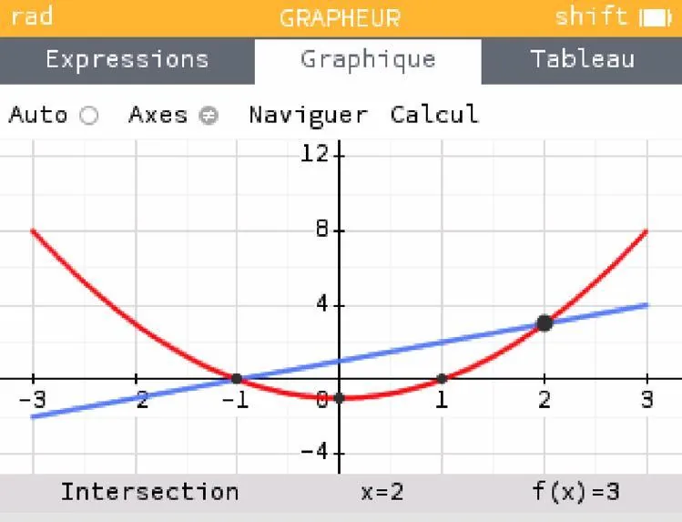

Résoudre graphiquement une inéquation de la forme $f(x)<g(x)$ consiste à repérer les domaines de $x$ dans lesquels la courbe représentative de $f$ est en dessous de celle de $g$.

Pour cela, on trace généralement les fonctions à l’aide d’un outil numérique (comme la calculatrice NumWorks), puis on repère les abscisses des points où les courbes se croisent, et la position des courbes entre ces points.

**Exemple :** soient les fonctions définies pour $x \in [-3\,;3]$ par :

- $\color{red} {f(x)=x^2-1}$
- $\color{blue}{g(x)=x+1}$

L'inéquation $f(x)<g(x)$ a pour solutions $x\in\, ]-1\,;2[$ (entre les deux points d'intersection, là où la courbe de $f$ est en dessous de celle de $g$).

**Remarque :** pour $x \in [-3\,;-1[ \cup ]2\,;3]$, on a $f(x)>g(x)$ car la courbe de $f$ est au-dessus de celle de $g$.
