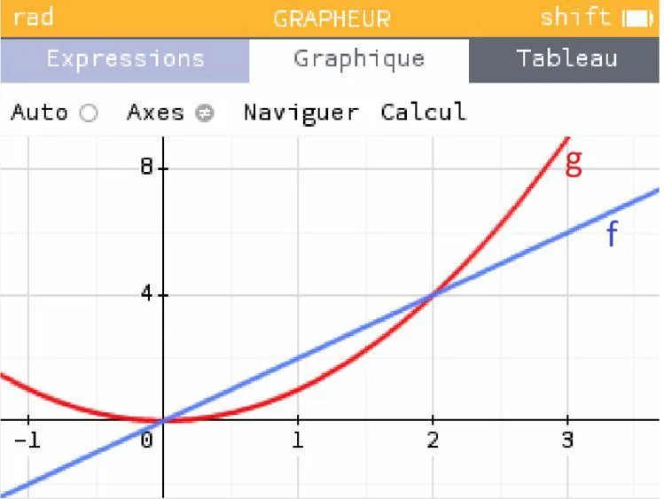
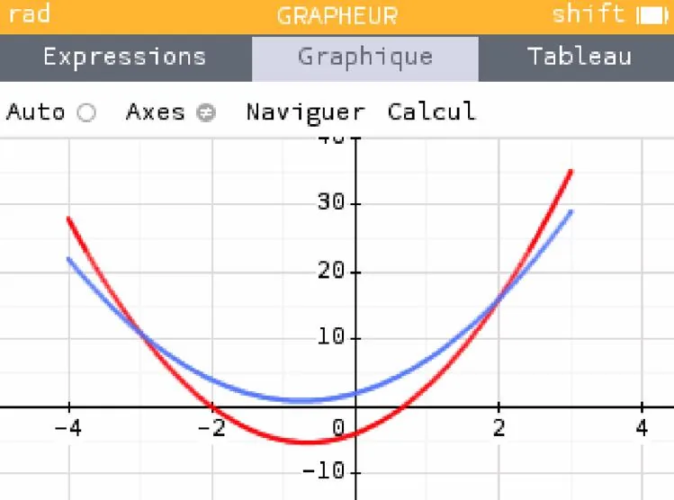

1. Voici la représentation des fonctions $\color{blue}{f}$ et $\color{red}{g}$. Résoudre $f(x)>g(x)$.

   

2. Voici la représentation des fonctions $\color{blue}{h}$ et $\color{red}{i}$. Résoudre $h(x)<i(x)$.

   
