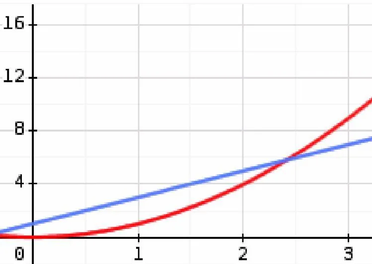

On considère les fonctions suivantes :

- $f(x)=x^2$
- $g(x)=2x+1$

1. À l'aide du graphique suivant, estimer une valeur de $x$ à 0,5 près telle que $f(x)=g(x)$.

   

2. Exécuter le code de la console Basthon. Que réalise-t-il ?

   ::: ouvrir https://console.basthon.fr/?script=eJxlU0tu20AM3RvQHYh4EdtpjErZGbWBFEVXRVGgRVfdjCWOMuh4pMwnncIN0Gv0BvE5dJOepJyP7SgVYEB-JB8f-agpvBsOXChhRaegQUM_54F3qg6IKSYNcuAzP18VE6BHo3VagV8sqmKSou1_0Wrh4QrKkDCFT0yz3fBkdSB3sGWS_WQtUu1w6Jm2sIbXxaRnJrwsqYjk0OtNqv7KtGBbidB3TgOVWKwtaiCkvmOqxR0qS6LBiFYRqdWde0Cqf8-kwTGHSSTGdvX3QHGJqmaNjhTFxJdU9bELJL46vYb6t1ky1N2ulxjbyUuhSMcDk5KyftwJEnQc6M0aaIa8Eu6Ji89ybJ7ANoDtC7ARnIdcD9eUEFoHdAq3nAualfqjApnGDJFek4QZvwhc-0y1Wpb8EX5FxwLM_Wp5E5E2I-0JiTnXp0BoH0MX83PvzwJ4mssYhDYtUDLqjTsxPGmkUxEmZQsOqrOQHWCqCaNsaJS8ifDEJVOCao7DkwIifwXl_FlW9TJrHD-Z_EU7DDLpdtXf338YbNF0QkWDSBoTJPDeUcSpo9K869z8ah26J5vPeyb3mEwuj06EJkytV2MHvqnNZgMfGJhOuvwlUe1wuHcs_s12xFWjsWQkfQ6w9-Uj0DntfRWXjnSxI-ZMfOtqp-CZkqRiOIAhN2piON_iMhD9A93GL_I
   :::

3. D'après l'exécution du programme, quelle est l’approximation de la solution de $f(x)=g(x)$ à 0,1 près ?

4. Modifier le programme pour obtenir une précision de 0,01.

```python
# Définition des deux fonctions
def f(x):
    return x**2

def g(x):
    return 2*x + 1

# Paramètres du balayage
départ = 0
pas = 0.1
fin = 3

# Variable pour détecter le changement de signe
trouve = False

# Variables pour stocker l'encadrement
x1 = None
x2 = None

# Balayage complet de l'intervalle
while départ <= fin:
    fx = f(départ)
    gx = g(départ)
    diff = fx - gx

    # Affichage en ligne
    print(f"x = {départ:.1f} | f(x) = {fx:.3f} | g(x) = {gx:.3f} | f(x) - g(x) = {diff:.3f}")

    # Si f dépasse g pour la première fois
    if not trouve and fx > gx:
        x1 = round(départ - pas, 1)
        x2 = round(départ, 1)
        trouve = True  # on n’a besoin de le faire qu’une fois

    départ += pas

# Affichage final de l'encadrement
if trouve:
    print(f"\n>>> La solution de l'équation f(x) = g(x) est entre {x1} et {x2}")
else:
    print("\n>>> Aucun encadrement trouvé sur cet intervalle.")
```
