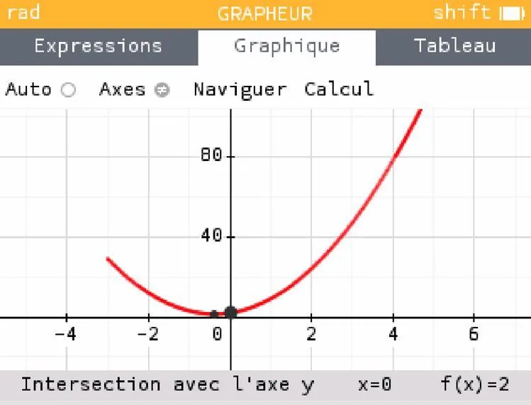
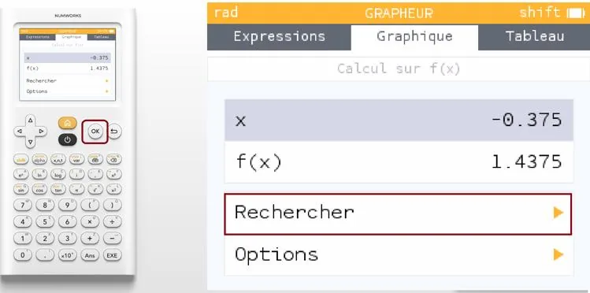
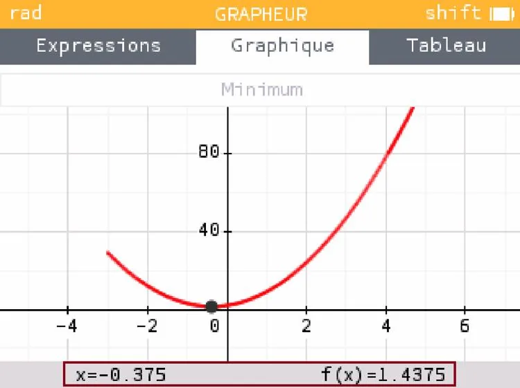

1. Tracer la forme graphique de la fonction à étudier.

   

2. Appuyer sur la touche **« Ok »** puis **« Rechercher »**.

   

3. Sélectionner **« Minimum »** ou **« Maximum »** en fonction de ce que vous cherchez, puis lire les coordonnées du minimum (ou du maximum).

   
