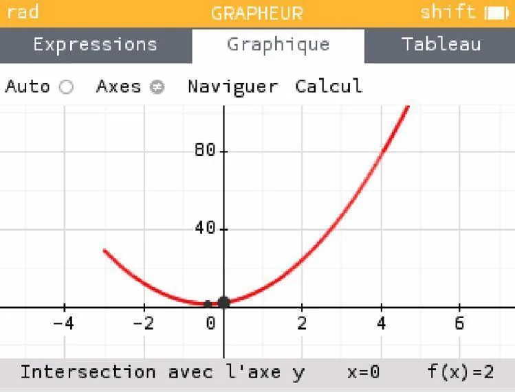
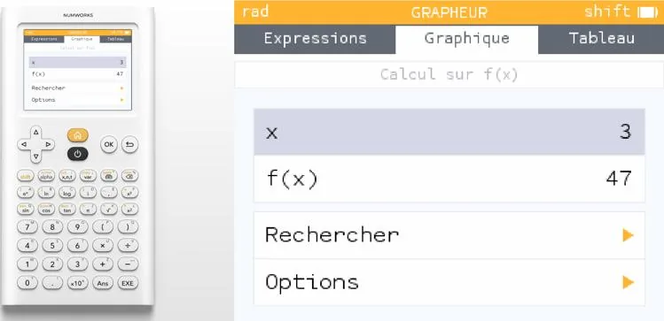
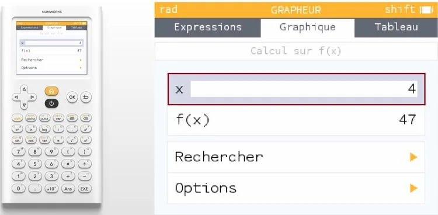
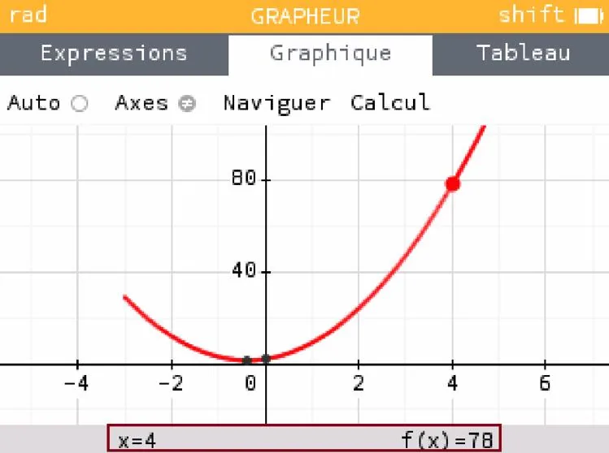
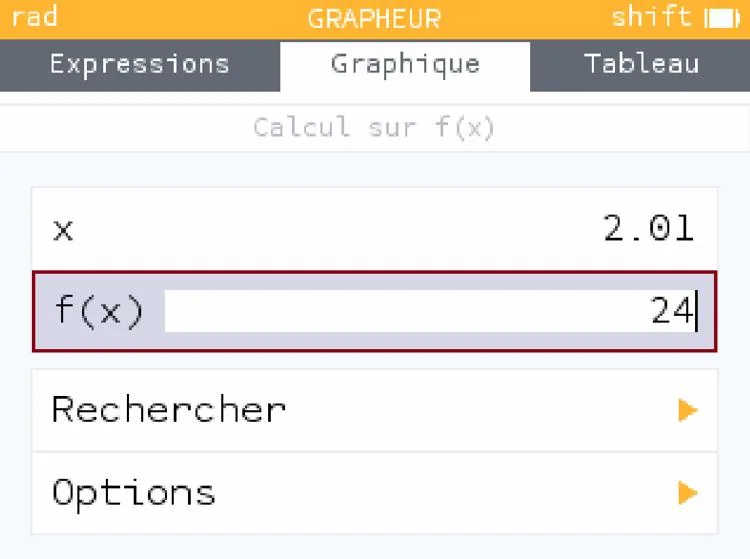
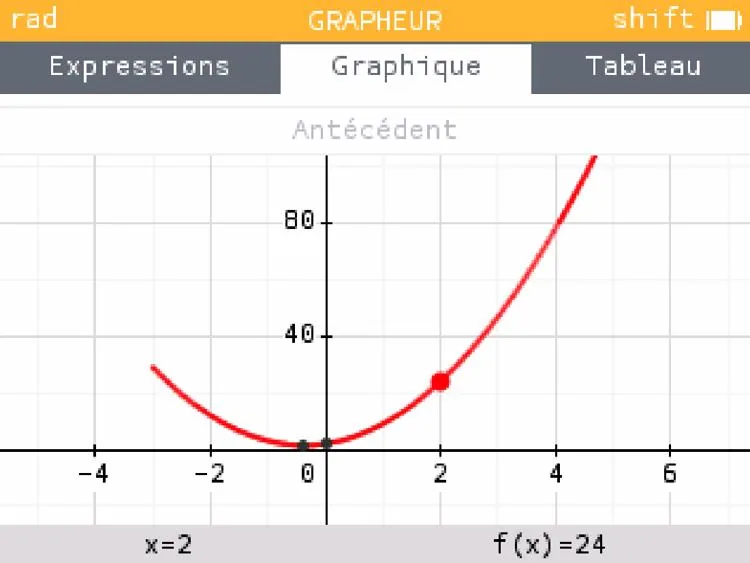
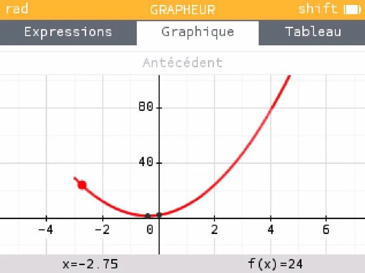

1. Tracer la forme graphique de la fonction à étudier.

   

2. Appuyer sur la touche **« Ok »**.

   

3. Mettre en $x$ la valeur pour laquelle on souhaite calculer l'image, puis appuyer sur **« Ok »**.

   

4. Lire la valeur associée. Dans cet exemple, l'image de 4 est 78.

   

5. Si l'on cherche un antécédent, la méthode est la même.

   

6. Par exemple, ici, 2 est un antécédent de 24.

   

   **Remarque :** -2,75 est aussi un antécédent de 24. Il est possible de lire la valeur en appuyant sur la flèche de droite pour se positionner sur le point.

   
