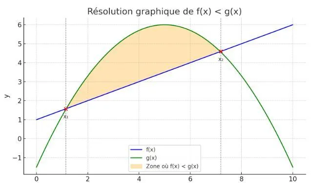

Pour résoudre une inéquation de la forme $f(x)<g(x)$, on cherche les valeurs de $x$ pour lesquelles la courbe représentant $f$ est en dessous de la courbe représentant $g$. Pour cela, il faut :

1. Tracer les courbes représentatives de $f$ et de $g$ dans un même repère.

2. Identifier les points d’intersection des deux courbes : ce sont les solutions de l’équation $f(x)=g(x)$.

3. Observer visuellement les zones où la courbe de $f$ est en dessous de celle de $g$.

4. Lire les abscisses correspondantes : ce sont les solutions de l’inéquation.

   

   **Remarques**

   - Si la courbe de $f$ est en dessous de celle de $g$, alors on a $f(x)<g(x)$.
   - Si elle est au-dessus, on a $f(x)>g(x)$.
   - Le changement de position entre les deux courbes se produit aux points d’intersection.
