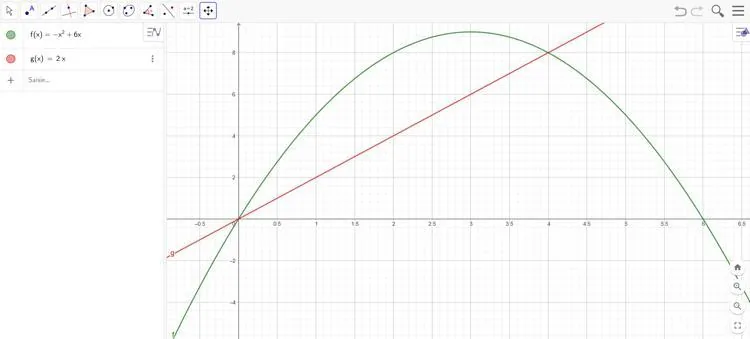
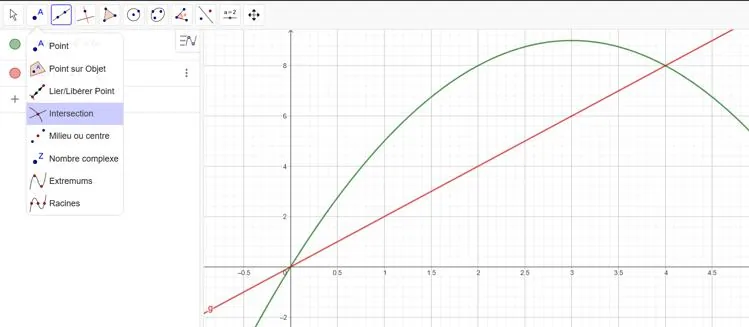
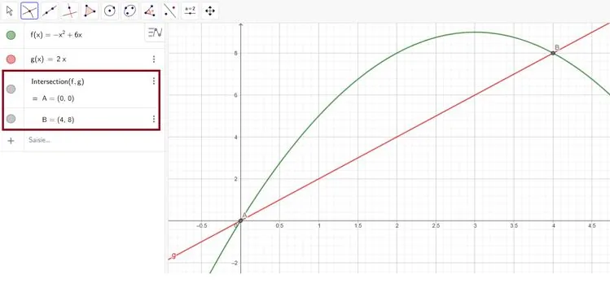

Trouvons le ou les points d'intersection des fonctions définies par :

- $f(x)=-x^2+6x$
- $g(x)=2x$

1. Ouvrir GeoGebra et tracer les deux fonctions.

   

2. Cliquer sur **« Intersection »**, puis sélectionner l'une après l'autre les deux fonctions.

   

3. Lire les coordonnées des intersections dans la fenêtre algèbre.

   

   Ici, les fonctions $f(x)$ et $g(x)$ sont égales pour $x=0$ et $x = 4$.
