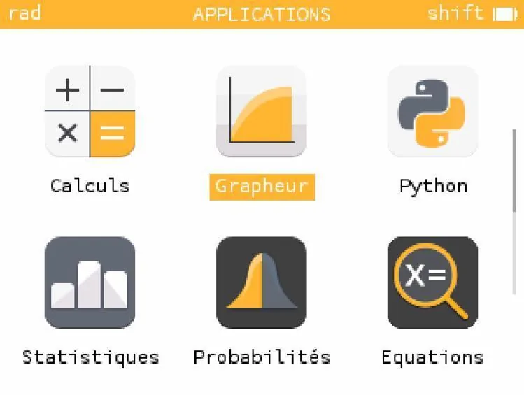
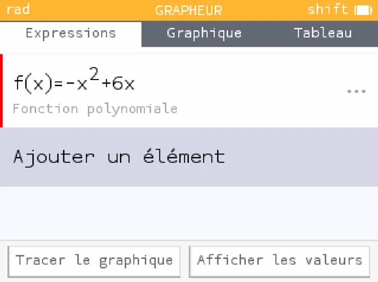
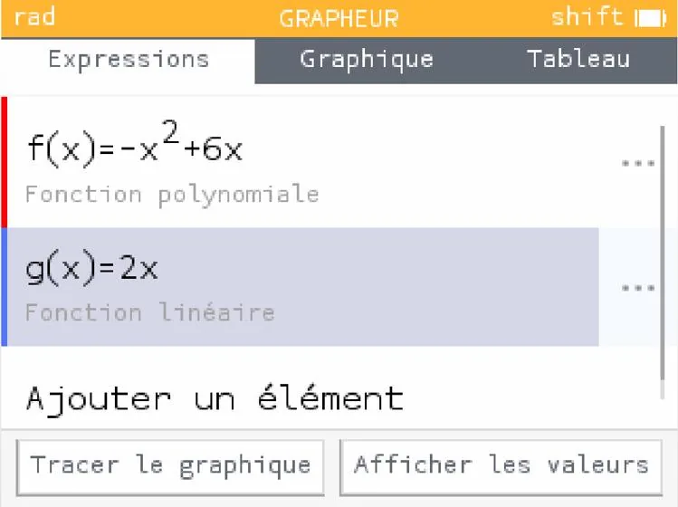
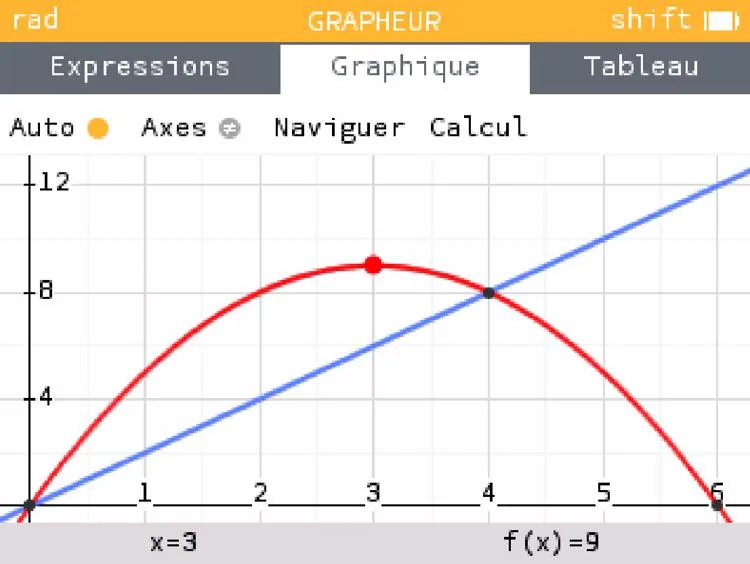
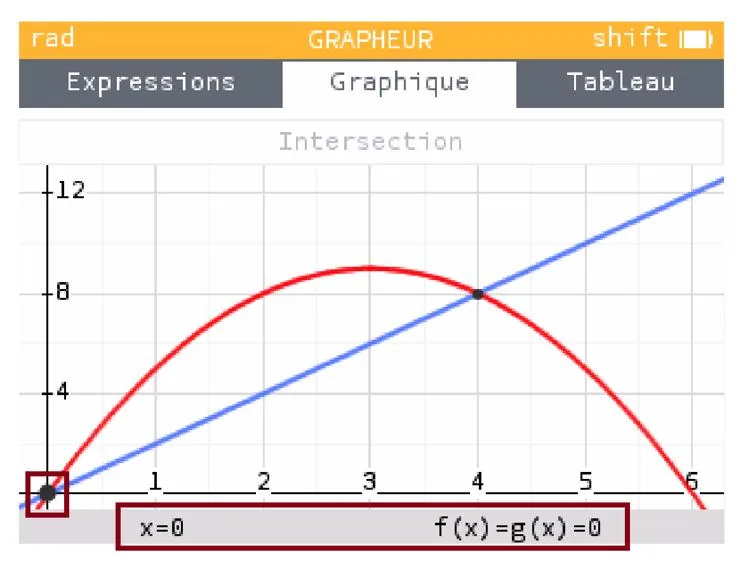
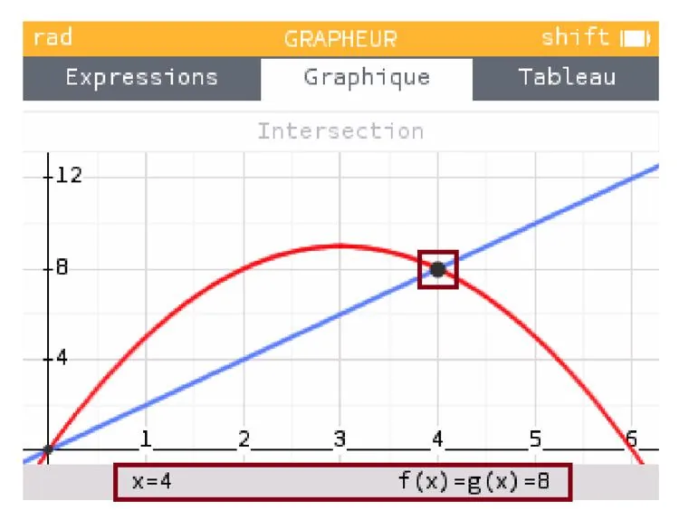

Cherchons le ou les points d'intersection des fonctions définies par :

- $f(x)=-x^2+6x$
- $g(x)=2x$

1. Ouvrir NumWorks et aller dans la fenêtre **« Grapheur »**.

   

2. Cliquer sur **« Ajouter un élément »**, puis saisir l'expression de la première fonction.

   

3. Cliquer à nouveau sur **« Ajouter un élément »**, puis saisir l'expression de la deuxième fonction.

   **Remarque :** il n'est pas nécessaire d'écrire « g(x) ». NumWorks se charge tout seul de nommer la deuxième fonction ; il ne faut donc écrire que son expression algébrique.

   

4. Cliquer sur **« Tracer le graphique »**.

   

5. Cliquer sur la touche **« Ok »**, puis sélectionner **« Rechercher »**, puis **« Intersection »**.

   

6. Ici, on a localisé le point d'intersection à gauche. On peut aussi localiser le point d'intersection à droite en appuyant sur la flèche de droite.

   

   **Conclusion :** les fonctions $f(x)$ et $g(x)$ ont deux points d'intersection, en $x=0$ et en $x=4$.
