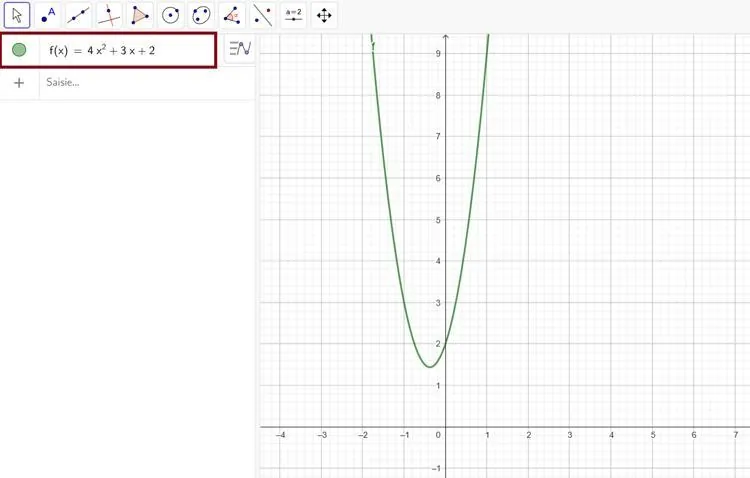
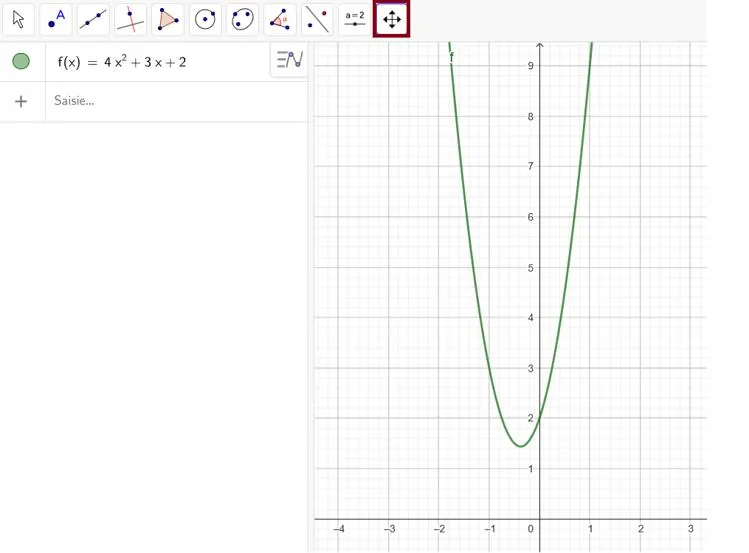
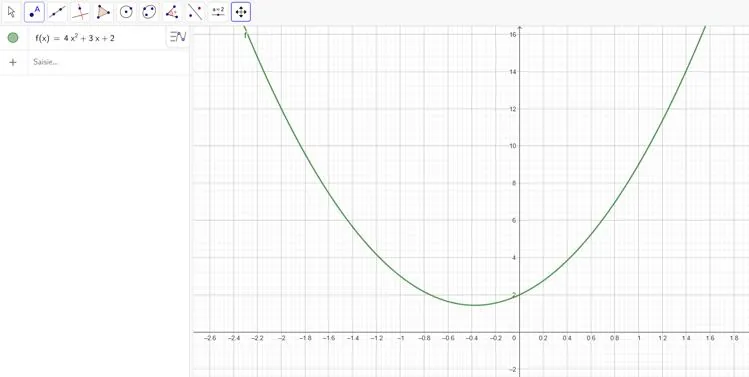

Traçons la fonction $f(x)=4x^2+3x+2$.

1. Ouvrir GeoGebra, écrire dans la fenêtre algèbre l'expression de la fonction $f(x)$, puis appuyer sur **Entrer**.

   

2. Contrôler la fenêtre en sélectionnant l'outil **« Déplacer Graphique »**, puis en cliquant sur les axes.

   

3. La fonction est désormais correctement tracée.

   
