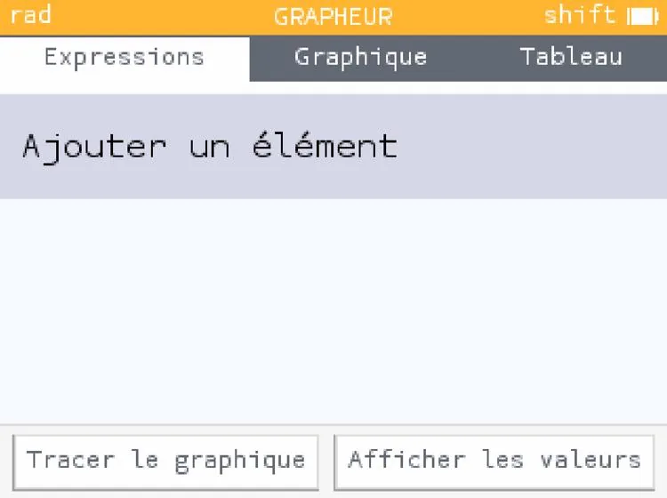
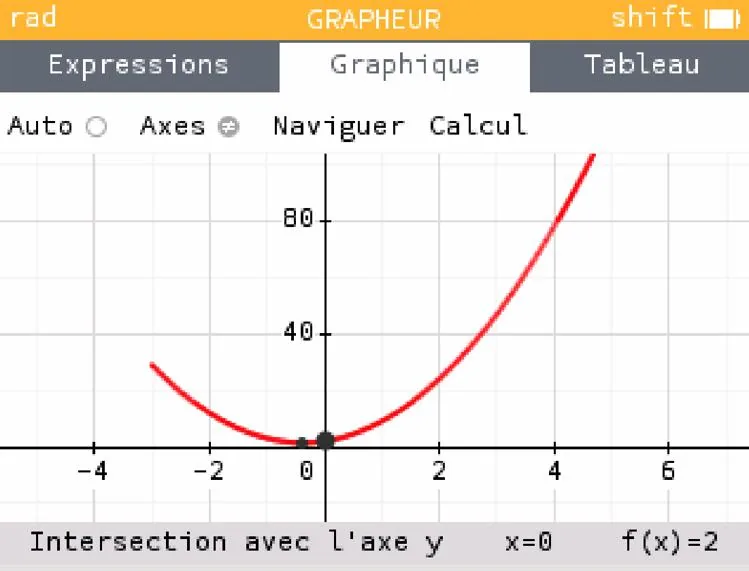

Traçons la fonction $f(x)=4x^2+3x+2$ pour $x \in [-3\,;7]$.

1. Ouvrir NumWorks et sélectionner « **Grapheur** » à l'aide des flèches.

   

2. Sélectionner « **Ajouter un élément** ».

   

3. Saisir la forme algébrique de la fonction à tracer puis appuyer sur **« Ok »**.

   **Remarque :** il n'est pas nécessaire d'écrire « f(x)= », NumWorks l'ajoutera automatiquement.

   

4. Sélectionner les « **...** » sur le côté droit.

   

5. Sélectionner **« Domaine de tracé »**.

   

6. Saisir le domaine de définition de la fonction, puis « **Valider** ».

   

7. Sélectionner « **Tracer le graphique »**.

   

8. La forme graphique de la fonction s'affiche.

   
